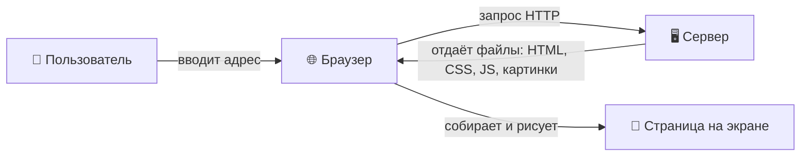

# 🌐 Урок 1. Введение в веб-разработку. Знакомство с инструментами вёрстки

<p align="center">
  
  
  
  
</p>

<p align="center">
  
  
  
  
  
</p>

---

## 📚 Содержание

- [1. Цели урока](#-1-цели-урока)
- [2. Что такое веб-разработка](#-2-что-такое-веб-разработка)
- [3. Как работает веб](#-3-как-работает-веб)
- [4. Три кита фронтенда](#-4-три-кита-фронтенда)
- [5. Инструменты вёрстки](#-5-инструменты-вёрстки)
- [6. Практика: первая страница](#-6-практика-первая-страница)
- [7. Домашнее задание](#-7-домашнее-задание)
- [8. Чек-лист преподавателя](#-8-чек-лист-преподавателя)

---

## 🎯 1. Цели урока

> [!IMPORTANT]
> После этого урока вы сможете:

- ✅ объяснить, из чего состоит веб-разработка и чем занимается фронтендер;
- ✅ описать путь страницы от адреса в браузере до экрана пользователя;
- ✅ создать первый файл `index.html` и открыть его в браузере;
- ✅ использовать редактор кода VS Code и писать проект в нем;

<br>


---

## 🌍 2. Что такое веб-разработка

<div align="center">
  <table>
    <tr>
      <th>🎨 Фронтенд</th>
      <th>⚙️ Бэкенд</th>
    </tr>
    <tr>
      <td>Всё, что видит пользователь:<br>вёрстка, дизайн, анимации</td>
      <td>Всё, что работает «под капотом»:<br>серверы, базы данных, логика</td>
    </tr>
    <tr>
      <td><b>HTML + CSS + JavaScript</b></td>
      <td><b>Python, PHP, Node.js, SQL</b></td>
    </tr>
  </table>
</div>

> [!TIP]
> **Вёрстка** — это превращение макета (картинки от дизайнера) в живую страницу с помощью HTML и CSS. Это первый навык любого фронтендера.

<br>

---

## 🔄 3. Как работает веб



<details>
<summary>📖 <b>Развёрнутое объяснение (если есть время)</b></summary>

1. Пользователь вводит адрес — например, `yandex.ru`.
2. Браузер отправляет **запрос** на сервер, где «живёт» сайт.
3. Сервер возвращает набор файлов: разметку, стили, скрипты, изображения.
4. Браузер читает HTML, находит подключённые CSS и JS, «собирает» всё в готовую страницу — это называется **рендерингом**.
5. Полезная аналогия: HTML — скелет, CSS — одежда, JS — действия. Браузер — мастер, который всё это склеивает.

</details>

> [!NOTE]
> 💡 Совет: нажмите `F12` на любом сайте → вкладка **Network** → перезагрузите страницу. Браузер качает файлы!

---

## 🏗 4. Три кита фронтенда

| Технология | Роль | Вопрос, на который отвечает | Пример |
|:---:|:---:|:---|:---|
| 📜 **HTML** | Скелет | *Что* есть на странице? | `<h1>Привет!</h1>` |
| 👗 **CSS** | Внешность | *Как* это выглядит? | `color: steelblue;` |
| ⚡ **JavaScript** | Поведение | *Что* делает страница? | кнопка реагирует на клик |

<div align="center">

| | |
|:---:|:---:|
| 📋 без HTML | нет страницы вообще |
| 👗 без CSS | скучный текст 1995 года |
| ⚡ без JS | ничего не реагирует, но выглядит красиво |

</div>

---

## 🛠 5. Инструменты вёрстки

### ✏️ Редактор кода — VS Code

<div align="center">
  
  
</div>

<p align="center"><b>Что нужно уметь на первом уроке:</b></p>

1. Создать папку проекта `my-site`.
2. Создать файл `index.html`.
3. Альтернативы для эрудиции: Sublime Text, Notepad++, WebStorm.

> [!NOTE]
> 💡 Совет: чаще всего проблема в имени файла или папки, внимательно пишите названия, или копируйте из документа!


<br>

<details>
<summary>💼 <b>Полный набор инструментов</b></summary>

| Инструмент | Зачем нужен | Обязателен? |
|:---|:---|:---:|
| **VS Code** | писать код | ✅ |
| **Live Server** | живой предпросмотр страницы | ✅ |
| **DevTools (F12)** | смотреть и править любую страницу | ✅ |
| **Figma** | макеты от дизайнера | 👀 посмотреть |
| **CodePen / JSFiddle** | онлайн-песочницы без установки | 👀 посмотреть |
| **Git** | хранение версий кода | урок в будущем |

</details>

<br>

> [!WARNING]
> 🚨 **Запуск несколькими способами** Вы можете запустить файл как обычно кликом из проводника или в VSCode `cntr + F5` если находитесь на странице `html`. Когда VS предложит выбрать браузер для запуска - выберите тот который есть у вас на компе (Google Chrome, Edge, Yandex Brauser, Firefox).

---

## 💻 6. Практика: первая страница

### Шаг 1. Каркас страницы

> Сразу скопируйте код ниже в IDE (VSCode), а потом продолжайте по пунктам читать далее и сверяйте с кодом.
> 
> Теги - это участки (зеленая подсветка синтаксиса) которые могут содержать или отображать что либо (элементы, картинки, текст, видео, звук и тд.).
> 
> Теги бывают `одиночными` и `двойными`. Двойные должны открываться (пример: `<h1>`) и закрываться (пример: `</h1>`).
> 
> Одиночные не имеют закрывающейся копии, то есть они полноценны сами по себе, а значит хранят что то одно и не нуждаются в начале и конце.
> 
> Самый важный тег - `<html> ... </html>` все должно быть написано внутри него.
> 
> Внутри `html` идут два также важных разделения: тег `<head> ... </head>` и тег `<body> ... </body>`.
> 
> К ним тоже большое внимание, для начала - они должны находиться внутри `html` сначала `head` - затем `body`.
> 
> Перевод банальный - голова и тело! А это значит в голове вся инфа о вашем сайте - и она невидима, а в теле - то что увидит пользователь на странице!

```html
<!DOCTYPE html>
<html>
<head>
    <title>Моя первая страница</title>
</head>
<body>
    <h1>Привет, мир!</h1>
    <p>Меня зовут ..., и это мой первый сайт.</p>
    
</body>
</html>
```

### Шаг 2. Магия ✨

Открываем страницу комбинацией `cntr + F5`на странице `html`, или просто кликом по файлу в проводнике — она живая! Каждое сохранение файла не обновляет браузер автоматически - нужно нажимать кнопку `restart` - зеленая круглая стрелочка в редакторе.
Или остановите сайт и запустите заново. Вы должны увидеть отрисованные текстовые заголовки. Попробуйте поменять текст в коде `html` файла и перезапустить несколько раз.

<br>


## 🏠 7. Домашнее задание для кача скилла!

> [!NOTE]
> ### 📌 Повтори тоже самое по памяти и если есть силы иди по следующим пунктам:
> - ✅ Найди в браузере текст (любой абзац или больше) и вставь его в тег <p> с помощью `cntr + c` и `cntr + v`.
> - ✅ Добавить новый тег `<button></button>`.
> - ✅ Создай все типы заголовков от `<h1>` до `<h6>`.

<details>

---

<p align="center">
  
</p>

<p align="center"><i>Если у тебя все получилось включая самостоятельную работу дома - ты качнул скилла и очень скоро сможешь называть себя разрабом!</i></p>
